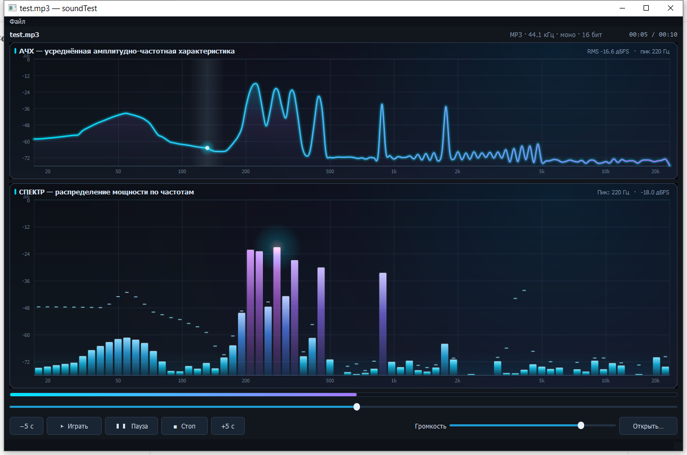

# soundTest — MP3-плеер со спектральным анализом

Учебный проект на Qt: воспроизведение MP3 через `libmpg123` + `libao` и
визуализация сигнала в реальном времени.



## Что показывает программа

Два синхронных анимированных графика, которые обновляются во время
воспроизведения:

1. **АЧХ** — усреднённая по времени амплитудно-частотная характеристика
   (сглаженная кривая с градиентной заливкой и бегущим маркером).
2. **СПЕКТР** — распределение мощности по частотам: 72 логарифмические
   полосы от 20 Гц до 20 кГц, градиентные столбики, удержание пиков и
   подсветка самой громкой полосы.

Обе шкалы логарифмические по частоте (20 Гц … 20 кГц) и в дБFS
(0 … −78 дБ). В заголовке графика выводятся пиковая частота, её уровень,
RMS и состояние сигнала.

## Как это устроено

```
поток воспроизведения                 GUI-поток
──────────────────────                ─────────────────────────────
mpg123_read()                         QTimer 16 мс
   │                                     │
   ├─ pushPcm16() ── lock-free ──► SpectrumAnalyzer::frame()
   │   кольцевой буфер              │  БПФ 4096, окно Ханна
   │                                │  лог-полосы, усреднение АЧХ
   └─ ao_play()                     ▼
                                  SpectrumWidget (QPainter)
```

- **`SpectrumAnalyzer`** — lock-free кольцевой буфер моно-семплов
  (`std::atomic<size_t>`), БПФ radix-2, окно Ханна, нормировка амплитуды,
  логарифмическое разбиение на полосы, экспоненциальное усреднение АЧХ,
  поиск пика с параболической интерполяцией и расчёт RMS.
- **`SpectrumWidget`** — собственный виджет на `QPainter` (без
  `QGraphicsScene`): антиалиасинг, градиенты, свечение, Catmull-Rom
  сглаживание кривой, плавная атака/спад значений и анимация при
  отсутствии сигнала.
- Поток воспроизведения больше не обращается к виджетам Qt: он только
  складывает семплы в буфер анализатора. Это устраняет гонку данных и
  падения при перерисовке.

## Что исправлено по сравнению с исходной версией

- Вместо «осциллограммы» из сырых байт MP3-потока — настоящий спектр (БПФ)
  и АЧХ.
- Данные для графиков декодируются в семплы (`int16`/`uint8`, сведение
  стерео в моно), а не берутся как `unsigned char` из потока.
- Убрана гонка между потоком декодирования и GUI за `sndbuffer`.
- Перерисовка больше не создаёт/не пересоздаёт сотни графических элементов:
  виджет рисует всё за один `paintEvent`.
- Исправлены остановка/пауза/перемотка: seek выполняется в аудиопотоке,
  а не из GUI; поток корректно завершается при открытии нового файла и в
  деструкторе; прогресс и время считаются в PCM-кадрах.
- Работает изменение громкости после открытия файла.
- Перемотка: клик в любом месте шкалы времени сразу переходит в эту точку,
  а перетаскивание ползунка выполняет переход по отпускании мыши. Пауза
  «замораживает» графики на последнем кадре, а не гасит их в ноль.
- Интерфейс переведён на компоновки (layout) и тёмную тему, поэтому окно
  можно нормально растягивать.

## Управление

- **Файл → Открыть…** (`Ctrl+O`) — выбрать MP3.
- **▶ Играть**, **❚❚ Пауза**, **■ Стоп**, **−5 c / +5 c**.
- Шкала времени под графиками: клик — переход в точку, перетаскивание
  ползунка — переход по отпускании.
- **Громкость** — регулятор справа внизу.
- Можно запустить файл сразу из командной строки:
  `./soundTest track.mp3`.

## Сборка

Linux (Debian/Ubuntu):

```bash
sudo apt install qtbase5-dev libmpg123-dev libao-dev
qmake soundTest.pro
make -j4
./soundTest
```

Windows (MSYS2/UCRT64):

```bash
pacman -S mingw-w64-ucrt-x86_64-qt5-base \
          mingw-w64-ucrt-x86_64-mpg123 \
          mingw-w64-ucrt-x86_64-libao \
          mingw-w64-ucrt-x86_64-make
qmake-qt5 soundTest.pro
mingw32-make -j4
```

## Файлы

- `spectrumanalyzer.*` — потокобезопасный FFT-анализатор.
- `spectrumwidget.*` — анимированные графики спектра и АЧХ.
- `mainwindow.*`, `mainwindow.ui` — плеер и компоновка интерфейса.
- `soundchart.*` — старый класс столбиков; больше не входит в сборку
  (оставлен для истории).
